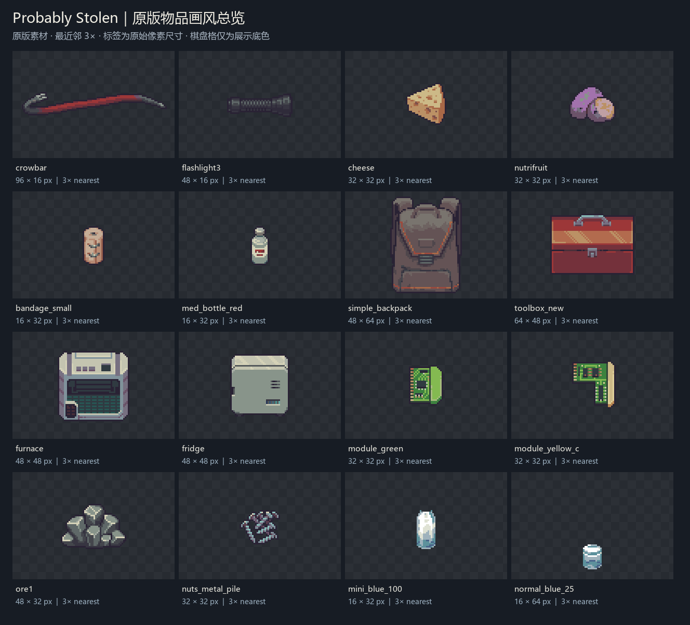

> Current developer guide. See [release status](current-status.en.md): original artwork is a separately licensed reference set. Full current-DLL native acceptance remains pending.

# Item artwork matching the original game

For a Mod item that should fit Probably Stolen's visual style, use the optional [original-art reference set](art-reference/README.md). It is included in the developer documentation and SDK, not the player package, and is not a runtime requirement.

For matching hover text, also choose the [optional native Tooltip recipe](tooltip-style.en.md). Artwork and text layout are separate concerns; avoid attribution and repeated names/stats when following native style.

1. Pick the matching category below, or two or three transparent images from `art-reference/enlarged-4x/`.
2. Give those images and the [English prompt](art-reference/AI-PROMPT.en.txt) to the image model. Specify your item's structure, material and target logical pixel dimensions.
3. Review the result at its intended small size: silhouette, consistent pixel grid, limited detail, real alpha and agreement with the references.
4. Bind your new PNG using [content packs](content-packs.zh-CN.md) or [SpriteAssets](sprite-assets.zh-CN.md). Artwork reference is optional.

| Category | Reference board |
| --- | --- |
| Hand tools and equipment | [Tools](art-reference/boards/01-tools.png) |
| Food and drinks | [Food](art-reference/boards/02-food-drink.png) |
| Medical supplies | [Medical](art-reference/boards/03-medical.png) |
| Bags and storage boxes | [Containers](art-reference/boards/04-containers.png) |
| Machines and operating states | [Machines](art-reference/boards/05-machines.png) |
| Modules and electronics | [Electronics](art-reference/boards/06-modules-electronics.png) |
| Materials and seeds | [Materials](art-reference/boards/07-materials-nature.png) |
| Liquid fill overlays, without complete container shells | [Liquid states](art-reference/boards/08-liquid-states.png) |

There are 96 original-resolution RGBA PNGs, matching 4x nearest-neighbor PNGs and eight category boards. Board labels give original dimensions. Overview is 3x; category boards are 4x. The checkerboard, captions and background are presentation aids, not artwork to generate. The [palette sheet](art-reference/09-palette-reference.png) shows frequent colors measured from these examples; it is not an official mandatory palette.

All selected Sprite widths and heights are multiples of 16. Use 16 pixels per cell as an initial drawing convention for ordinary items, then check the relevant original. Sprite dimensions alone do not establish inventory occupancy; declare the actual shape separately. Special images, UI and portraits can differ. EZapi does not impose a new multiple-of-16 loading restriction.

A multiple-of-16 canvas does not prevent blur. Design on the final logical pixel grid with limited readable detail. Enlarge by an integer factor with nearest-neighbor sampling. Shrinking a detailed illustration can still destroy structure; irregular large-image pseudo-pixels do not become correct pixel art automatically. Preserve aspect ratio and check alpha edges. Original alpha is retained, including near-transparent alpha=1 pixels in some source textures.

Use references for pixel density, category-specific viewing angle, silhouette, palette and shading; create the new item's own structure. Liquid fills are overlays rather than complete bottle images. See [asset index](art-reference/art-reference.index.json), [workflow index](item-art.index.json) and [artwork rights](art-reference/NOTICE.md). Original game artwork is excluded from EZapi's MIT license.

File/hash/dimension checks establish reference integrity only; they do not establish generated-art quality or native gameplay acceptance.
